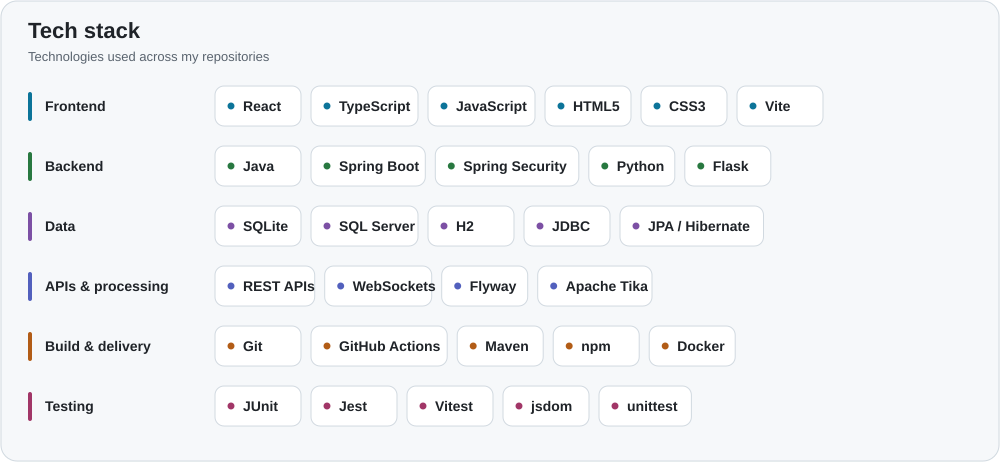

# Hi, I'm Saad

**Software engineering student at UIT University · Full-stack development**

I build web applications with Java, Spring Boot, React, and TypeScript, and develop Python APIs with Flask. I focus on clear API design, relational databases, and reliable user workflows.

[LinkedIn](https://www.linkedin.com/in/syedmsaad/) · [Explore my repositories](https://github.com/saadh472?tab=repositories)

## Selected projects

| Project | Engineering highlights |
| --- | --- |
| **[Document Processing Pipeline](https://github.com/saadh472/intelligent-document-processing-pipeline)** Java · Spring Boot · React · TypeScript | PDF, DOCX, and TXT uploads with text extraction, rule-based classification, and processing-stage tracking. [Automated checks](https://github.com/saadh472/intelligent-document-processing-pipeline/actions/workflows/quality.yml) |
| **[FoodHeaven](https://github.com/saadh472/foodheaven)** Python · Flask · JavaScript · SQLite | Employee CRUD, payroll, and shift scheduling with session authentication, CSRF protection, accessible controls, and failed-request recovery. [Automated checks](https://github.com/saadh472/foodheaven/actions/workflows/quality.yml) |
| **[ATM FSM Simulator](https://github.com/saadh472/atm-fsm-simulator)** Python · Flask · SQLite | Mealy and Moore state visualizations backed by validated ATM actions, persistent transactions, and protection against duplicate debits on retry. [Automated checks](https://github.com/saadh472/atm-fsm-simulator/actions/workflows/quality.yml) |
| **[Telegram Web Clone](https://github.com/saadh472/telegram-clone)** Python · Flask · JavaScript · SQLite | A messaging prototype with direct and group chats, attachments, and reactions through a layered REST API. [Automated checks](https://github.com/saadh472/telegram-clone/actions/workflows/quality.yml) |

## Tech stack

| Area | Technologies |
| --- | --- |
| Frontend | React · TypeScript · JavaScript · HTML5 · CSS3 · Vite |
| Backend | Java · Spring Boot · Spring Security · Python · Flask |
| Databases and access | SQLite · SQL Server · H2 · SQL · JDBC · JPA/Hibernate |
| APIs and document processing | REST APIs · WebSockets · Flyway · Apache Tika |
| Build and delivery | Git · GitHub Actions · Maven · npm · Docker configuration |
| Testing | JUnit · Jest · Vitest · jsdom · Python unittest |

I apply these tools to responsive interfaces, keyboard accessibility, input validation, session authentication, and reliable database transactions.

I'm continuing to strengthen application architecture and test coverage through practical projects.
